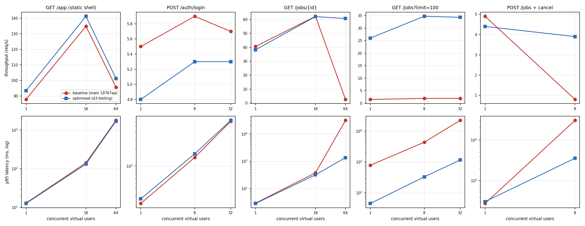

# 1. Summary

A closed-loop load test drove five API scenarios at rising concurrency against the code on `main` (`18767aa`, the **baseline**), found two bottlenecks, fixed both, and re-ran the identical test against the **optimised** build (branch `d3-testing`).

| Result | Baseline | Optimised | Change |
|---|---|---|---|
| `GET /jobs?limit=100`, 1 user: median latency | 674 ms | **37 ms** | **18× faster** |
| `GET /jobs?limit=100`: maximum throughput | 1.9 req/s | **34.7 req/s** | **18×** |
| `GET /jobs/{id}`, 64 users: throughput / median / errors | 2.6 req/s / 30.4 s / **31%** | **60.6 req/s / 1.0 s / 0%** | collapse removed |
| `POST /jobs` + cancel, 8 users: throughput / p95 / errors | 0.8 req/s / 30.5 s / **23%** | **3.9 req/s / 3.6 s / 0%** | 4.9× |
| `GET /app` (unchanged code, control) | 134.8 req/s peak | 141.2 req/s peak | +5% (run-to-run noise) |

**Optimisation 1 (D3-04):** `GET /jobs` loaded each job's status separately — 3 to 6 queries per job, plus a full reload of the lab's nodes for every queued job. It now loads the page in a fixed number of queries.
**Optimisation 2 (D3-07):** FastAPI runs each synchronous endpoint on one of 40 worker threads, but SQLAlchemy's default pool holds only 5 + 10 connections; threads 16–40 queued for a connection and failed after 30 s. The pool is now sized to the thread pool and configurable, and an exhausted pool answers 503 after 10 s instead of 500 after 30 s.

**Scheduler under real load (added by the GPU subsystem, section 7).** With node agents really running jobs, and a pool at the design peak, two further bottlenecks appeared that the scenarios above could not show. Both are fixed.

| Result | `main` | `d3-testing` | Final build |
|---|---|---|---|
| Four overlapping passes, 400 queued jobs: mean | 51,987 ms | 49,087 ms | **1,933 ms** |
| Mixed workload, 100 users: requests/s | 6.8 | 9.5 | **97.1** |
| Mixed workload, 100 users: errors | 136 | 254 | **0** |
| Mixed workload, 100 users: `submit` p95 | 30,038 ms | 19,166 ms | **137 ms** |

# 2. Test environment

| Item | Value |
|---|---|
| Machine | one Windows 11 laptop, 16 logical cores, 16 GB RAM; load generator, API and database on the same host (so absolute numbers are pessimistic, comparisons are fair) |
| API | `uvicorn main:app`, 1 process, default AnyIO thread pool (40) |
| Database | PostgreSQL 16 (local cluster, port 55432), database `prayog_d3_load`, migrated to head |
| Data | `seed_dev` world (5 accounts, 3 labs, 3 nodes × 4 units) + 100 jobs for `alice` (50 queued, 50 cancelled) via `evidence/seed_load.py`; nodes without agents, so queued jobs exercise the "when will my lab's GPUs be free" computation |
| Generator | `evidence/loadgen.py`: `httpx` async client, *N* virtual users in a closed loop (each sends its next request when the previous one returns), 15 s per step, every status code and transport error counted |
| Procedure | baseline server from a clean worktree of `18767aa`; then the optimised server from `d3-testing`; same database, run one after the other, nothing else running |

**Limitations.** One run per configuration (no confidence intervals): the unchanged static-file scenario differs by 5–6% between the runs, which is the noise level to read the other rows against. Single API process — production uses `--workers 4` (Deployment section 4.3). No GPU agents were running, so dispatch traffic is absent.

# 3. Results



| Scenario | VUs | Baseline req/s | Optimised req/s | Baseline p50 / p95 (ms) | Optimised p50 / p95 (ms) | Baseline errors | Optimised errors |
|---|---|---|---|---|---|---|---|
| GET /app (static shell) | 1 | 87.8 | 93.4 | 11 / 13 | 10 / 13 | 0.0%  | 0.0%  |
| GET /app (static shell) | 16 | 134.8 | 141.2 | 117 / 142 | 112 / 132 | 0.0%  | 0.0%  |
| GET /app (static shell) | 64 | 95.7 | 101.3 | 495 / 1769 | 458 / 1682 | 0.0%  | 0.0%  |
| POST /auth/login | 1 | 5.5 | 4.8 | 178 / 217 | 196 / 262 | 0.0%  | 0.0%  |
| POST /auth/login | 8 | 5.9 | 5.3 | 1348 / 1416 | 1488 / 1644 | 0.0%  | 0.0%  |
| POST /auth/login | 32 | 5.7 | 5.3 | 5214 / 6139 | 5830 / 6382 | 0.0%  | 0.0%  |
| GET /jobs/{id} | 1 | 40.6 | 38.2 | 24 / 30 | 25 / 29 | 0.0%  | 0.0%  |
| GET /jobs/{id} | 16 | 62.2 | 62.0 | 245 / 379 | 254 / 320 | 0.0%  | 0.0%  |
| GET /jobs/{id} | 64 | 2.6 | 60.6 | 30447 / 30960 | 1019 / 1359 | 31.2% (500×25) | 0.0%  |
| GET /jobs?limit=100 | 1 | 1.5 | 26.0 | 674 / 773 | 37 / 45 | 0.0%  | 0.0%  |
| GET /jobs?limit=100 | 8 | 1.9 | 34.7 | 4164 / 4316 | 223 / 325 | 0.0%  | 0.0%  |
| GET /jobs?limit=100 | 32 | 1.9 | 34.3 | 15364 / 21987 | 929 / 1154 | 0.0%  | 0.0%  |
| POST /jobs + cancel | 1 | 4.9 | 4.4 | 202 / 272 | 247 / 303 | 0.0%  | 0.0%  |
| POST /jobs + cancel | 8 | 0.8 | 3.9 | 1210 / 30548 | 1769 / 3556 | 23.1% (RemoteProtocolError×4, 500×2) | 0.0%  |

# 4. Analysis

## 4.1 `GET /jobs` — N+1 queries (D3-04)

The baseline handler did:

```python
ids = db.scalars(select(Job.id).where(Job.user_id == me).order_by(Job.id.desc()).limit(limit)).all()
return [_job_out(db, me, job_id, cfg) for job_id in ids]        # job_status() per job
```

and `job_status` issues, per job, a `get`, a last-run query, and either the allocation + unit (+ maintenance) queries or, for a queued job, `_p0_free_at`, which re-reads the lab's nodes, units, maintenance windows and busy allocations. For 100 jobs that is several hundred round trips, and a single user already waits 674 ms; at 8 users the CPU is saturated and throughput stays at 1.9 req/s.

The fix (`job_statuses` in `logic/gpu/scheduler/requests.py`) loads jobs, last runs, live allocations and their units with one query each, computes each lab's capacity picture once per request, and keeps one maintenance query per *started* running job. `job_status` (one job) now calls the same code, so the two can never disagree. `test_cases/gpu/test_job_list_batched.py` pins both promises: every job in the batch equals the single-job view field by field (queued with a non-null `p0_free_at`, running with a planned maintenance stop, scheduled-unacknowledged, completed, cancelled), and the number of SQL statements is the same for 8 jobs as for 39.

## 4.2 Pool exhaustion under concurrency (D3-07)

At 64 users `GET /jobs/{id}` — a cheap endpoint, 24 ms alone — collapsed to 2.6 req/s with 31% `500`s. The server log shows 32 × `QueuePool limit of size 5 overflow 10 reached, connection timed out, timeout 30.00`. Each request holds one session for its whole duration; with 40 threads and 15 connections, 25 threads wait, and every wait that passes 30 s becomes a 500 — a hang followed by an error, the worst behaviour for a client. The write scenario hit the same wall at only 8 users, because each submission also starts a scheduling pass in the background that takes its own connection.

The fix makes the pool `PRAYOG_DB_POOL_SIZE` (20) + `PRAYOG_DB_MAX_OVERFLOW` (20) = the thread pool, and `PRAYOG_DB_POOL_TIMEOUT_SECONDS` 10; a pool timeout is now answered 503 + `Retry-After` (fix D3-06). Throughput at 64 users is then the same as at 16 (≈ 61 req/s) — the CPU-bound ceiling of one process — with zero errors.

**Deployment consequence:** `workers × (size + overflow)` must stay below PostgreSQL's `max_connections` (100 by default). With 4 workers, either set size + overflow to 20 per worker, raise `max_connections`, or put PgBouncer in front (Deployment section 4.3).

## 4.3 Login is serialised per account (not changed)

`POST /auth/login` reaches ≈ 5.5 req/s for one account whatever the concurrency, and its median grows linearly (178 ms → 1.35 s → 5.2 s), i.e. the logins run one at a time. Our explanation, not yet confirmed by a measurement with many accounts: `authenticate_user` takes `SELECT … FOR UPDATE` on the user row *before* the ≈ 180 ms Argon2 verification (`logic/auth.py:124`), so concurrent logins of the same account wait for each other. That lock is what makes the lockout counter exact under parallel guessing (concurrency test C4), and serialising guesses against one account is itself a brute-force brake, so we kept it. Logins of different accounts do not share the lock. Recommended follow-up: repeat the login scenario with 32 distinct accounts to confirm that throughput then scales with cores.

## 4.4 Other observations

- The static web shell peaks at ≈ 140 req/s at 16 users and drops at 64 (p95 1.7 s): one uvicorn process serving files. In production nginx or a CDN serves `/app` assets.
- Single-user latency of the unchanged endpoints moved by up to ±12% between the runs (e.g. login 178 → 196 ms) — within the noise of a shared laptop, not attributed to the changes.

# 5. Performance requirements check

| Requirement | Target | Measured | Status |
|---|---|---|---|
| NFR-GPU: submission answered on the spot, `QUEUED` within `T_inprocess` (5 s) | ≤ 5 s | `POST /jobs` p95 0.30 s (1 user), 3.6 s (8 users, optimised); 30.5 s baseline | met after fix |
| Job status visible to the owner promptly | interactive (< 1 s) | `GET /jobs/{id}` p50 25 ms alone, 1.0 s at 64 concurrent users | met |
| Job list for a 100-job history | interactive | 37 ms (optimised) vs 674 ms | met after fix |
| NFR-GPU-014: a full pass at the design peak | p95 ≤ 1 s | one pass 165 ms; four at once 281 ms (section 7) | **met** |
| NFR-GPU-038: a claim with four concurrent passes | p95 ≤ 100 ms | 17.95 ms | **met** |
| NFR-GPU-039: `submit` and `status` at the design peak | p95 ≤ 500 ms and ≤ 300 ms | 67 ms and 31 ms at 25 users; 137 ms and 81 ms at 100 users | **met** |
| NFR-GPU-040: SCHEDULED within 15 s when units are free | ≤ 15 s | 0.63 s for 40 simultaneous submissions to fill a free node | **met** |
| NFR-GPU-041: sustain the design peak for one hour | no double allocation, no lost job | not run | **not measured** |

# 7. The scheduler under real load

This experiment complements the scenarios above. It runs the deployed stack (`docker-compose.deploy.yml`: four API workers, the tick, PostgreSQL 16), with node agents that really acknowledge, run and report jobs, so capacity turns over.

| Item | Value |
|---|---|
| Machine | One Windows 11 laptop, Docker Desktop on WSL2 (12 logical CPUs, 7.6 GB for Docker); generator, API and database on the same host |
| Pool | The design peak of requirement ASM-02: 20 GPU units on 5 nodes |
| Data | An empty database for each run, then 5,000 finished jobs of history |
| Workload | Closed-loop users with a mean 1 s think time: 45% status, 25% submit, 15% list, 10% cancel, 5% quota, for 60 s at each level. Jobs run for 20 s |
| Scripts | `backend/experiments/pass_benchmark.py`, `backend/experiments/load_test.py` |
| Procedure | The same scripts on three builds, each from a fresh database with nothing else running. Each image was checked to contain the expected code. Runs that overlapped a laptop sleep were discarded |

**Limits.** One run per build, on one laptop; single-pass figures moved by up to about 50% between otherwise identical runs, so only read large differences. This is a far heavier load than the design workload of 200–400 jobs a day: 100 users here generate about 97.1 requests a second.

## 7.1 Bottleneck: overlapping passes (D3-14)

| Queue and pool | One pass, final (p95 ms) | Four at once, `main` (mean ms) | Four at once, `d3-testing` (mean ms) | Four at once, final (mean ms) | Improvement over `main` | Statements per pass |
|---|---|---|---|---|---|---|
| 40 queued, 5 nodes x 4 units | 165 | 744 | 877 | **240** | 3× | 158 |
| 200 queued, 10 nodes x 4 units | 359 | 15,239 | 11,992 | **655** | 23× | 416 |
| 400 queued, 20 nodes x 4 units | 998 | 51,987 | 49,087 | **1,933** | 27× | 826 |

A single pass was never the problem. Passes overlap whenever events arrive close together, and a pass that lost a race kept working from its stale snapshot: every remaining job tried every node it still believed free, each attempt a full locking transaction followed by a rollback. The cost was jobs × nodes × passes.

**Fix.** A failed claim now updates that pass's own view of the node, so it stops retrying a node that cannot fit the job (`_Pass._learn`). The claim transaction still decides correctness, so this cannot cause a double allocation. `test_pass_equivalence` still passes over 400 random pools.

## 7.2 Bottleneck: one pass per event (D3-15)

| Users | Build | Requests/s | Errors (5xx and dropped) | `status` p95 (ms) | `submit` p95 (ms) | `list` p95 (ms) | `cancel` p95 (ms) | Pass p95 (ms) |
|---|---|---|---|---|---|---|---|---|
| 5 | `main` | 4.8 | 0 | 21 | 49 | 78 | 57 | 24 |
| 5 | `d3-testing` | 4.8 | 0 | 23 | 83 | 26 | 55 | 46 |
| 5 | **final** | 4.8 | 0 | 23 | 50 | 31 | 55 | 20 |
| 10 | `main` | 9.8 | 0 | 27 | 62 | 115 | 67 | 36 |
| 10 | `d3-testing` | 9.8 | 0 | 27 | 62 | 58 | 63 | 43 |
| 10 | **final** | 9.8 | 0 | 26 | 56 | 32 | 50 | 22 |
| 25 | `main` | 20.8 | 0 | 1,033 | 605 | 628 | 820 | 723 |
| 25 | `d3-testing` | 18.8 | 0 | 1,491 | 1,437 | 1,412 | 1,138 | 1,458 |
| 25 | **final** | 24.4 | 0 | 31 | 67 | 45 | 95 | 42 |
| 50 | `main` | 8.8 | 12 | 15,650 | 10,151 | 10,178 | 7,563 | 10,223 |
| 50 | `d3-testing` | 9.2 | 63 | 10,005 | 10,005 | 10,007 | 9,189 | 8,858 |
| 50 | **final** | 49.2 | 0 | 36 | 73 | 45 | 152 | 83 |
| 100 | `main` | 6.8 | 136 | 30,030 | 30,038 | 30,031 | 30,019 | 28,852 |
| 100 | `d3-testing` | 9.5 | 254 | 16,360 | 19,166 | 15,983 | 12,520 | 10,059 |
| 100 | **final** | 97.1 | 0 | 81 | 137 | 102 | 248 | 731 |

On `main`, every submit, cancel, edit and run end started its own full pass. Above about 25 users these stacked up faster than they finished: at 50 users `main` manages 8.8 requests/s with `status` p95 at 15,650 ms, and at 100 users it falls to 6.8 requests/s with 136 errors.

**Fix.** `trigger_pass` allows one running and one owed pass per API process. The owed pass starts after the caller's change committed, so it sees that change, and nothing is lost. This keeps one pass per worker, which is what NFR-GPU-007 expects, and adds no global lock, which NFR-GPU-006 forbids.

**Credit.** The fixes interact. Areen's batched job list (D3-04) and pool sizing (D3-07) are in both `d3-testing` and the final build, and they lift the `list` column and remove the connection timeouts. D3-14 and D3-15 remove the pass storm. `backend/experiments/` reruns all of it.

## 7.3 What this does not show

- The load came from one laptop, not the t3.medium sized in the Costing document.
- Jobs here run for 20 s, so turnover is much higher than with real training jobs.
- A job's time to SCHEDULED under saturation depends on the queue ahead of it, not on the scheduler: in this mix the queue reaches hundreds of jobs, so the probe's p95 (14,874 ms) is not a measure of NFR-GPU-040, which applies only when units are free.

# 8. Reproducing

```bash
# The stack in section 7, from the repository root
docker compose -f docker-compose.deploy.yml up -d --build
# then, in the API image: python -m experiments.pass_benchmark, python -m experiments.load_test

# The scenarios in section 3
# seed (from backend/, with the load-test environment variables)
python <evidence>/seed_load.py
uvicorn main:app --port 8792 &
python <evidence>/loadgen.py http://127.0.0.1:8792 load.json optimised
python D3/src/make_load_charts.py                     # charts + the table above
```
