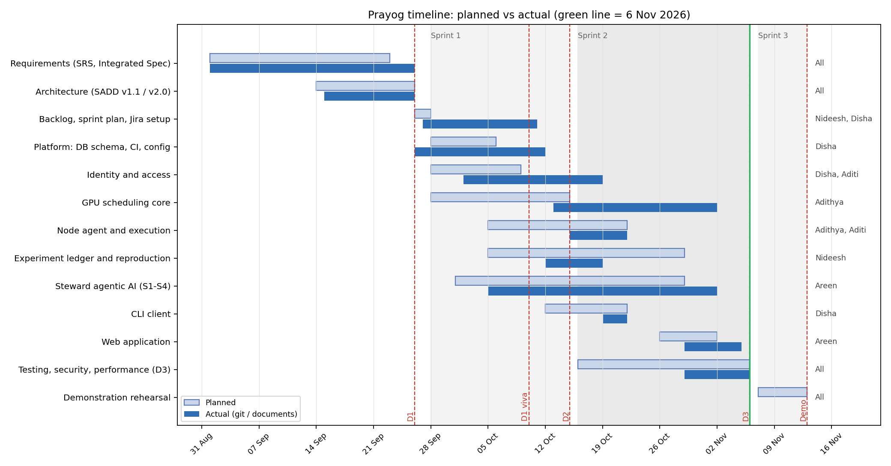

# 1. Gantt chart

Planned bars come from the sprint plan (`PRAYOG_Backlog_and_Sprint_Plan.md`, 27 Sep). Actual bars come from the repository: first and last commit on `main` touching each subsystem's code (`git log -- <path>`), and from document dates for the pre-sprint phases (requirements and architecture start dates are approximate; their end dates are the D1 documents' dates).

# 2. Milestones

| Milestone | Planned | Actual | Notes |
|---|---|---|---|
| D1 — requirements and architecture | 26 Sep | 26 Sep (submitted with SADD v1.1) | SADD v2.0 written 26 Sep, not in the submission |
| D1 viva | 10 Oct | 10 Oct | |
| Sprint 1 planning | 28 Sep | 28 Sep | Jira populated by bulk import on 11 Oct |
| D2 — implementation, Agentic AI, sprint execution | 15 Oct | 15 Oct | Steward merged (PR #11); ledger integrated (10 working-repository PRs) |
| Sprint 2 planning | 16 Oct | 16 Oct | |
| CLI complete | 22 Oct (plan: Sprint 2) | 22 Oct (PR #25) | |
| Web application for all roles | not in the plan | 5 Nov (PR #26) | added during Sprint 2 |
| D3 — testing, security, performance, cost, deployment, reliability | 6 Nov | 6 Nov | this package |
| Demonstration | 8–13 Nov | — | Sprint 3 |

# 3. Planned vs actual, by workstream

| Workstream | Planned | Actual (git) | Slip | Why |
|---|---|---|---|---|
| Platform: schema, CI, config | 28 Sep – 6 Oct | 26 Sep – 12 Oct | +6 days | CI grew with each subsystem (Docker worker, node-agent container) |
| Identity and access | 28 Sep – 9 Oct | 2 Oct – 19 Oct | +10 days | access-request `purpose` (PR #19) and CLI login added in Sprint 2 |
| GPU scheduling core | 28 Sep – 15 Oct | 13 Oct – 2 Nov | +18 days | started late (13 Oct, after the plan's calibration), then claim re-check, bucketed pass and review fixes in Sprint 2 |
| Node agent and execution | 5 – 22 Oct | 15 – 22 Oct | on time (compressed) | |
| Experiment ledger and reproduction | 5 – 29 Oct | 12 – 19 Oct | 10 days early | built in a separate working repository and merged as a block |
| Steward S1–S4 | 1 – 29 Oct | 5 Oct – 2 Nov | +4 days | integration with the real backend, CLI-rebuild gap (D3-01) |
| CLI client | 12 – 22 Oct | 19 – 22 Oct | on time | |
| Web application | 26 Oct – 2 Nov (added) | 29 Oct – 5 Nov | +3 days | full review and CI repair before merge |
| Testing, security, performance (D3) | 16 Oct – 6 Nov | 29 Oct – 6 Nov | started 13 days late | functional work overran; non-functional testing compressed into the last week (retrospective, Project report section 6) |

# 4. Critical path

Requirements → Integrated Specification → GPU scheduling core (claim, pass) → node agent and dispatch → ledger seal hook → Steward diagnosis → web app → D3 testing. The scheduling core was the longest single chain (it gates execution, the ledger's rebuilds and the Steward's inputs); its 18-day slip is what pushed non-functional testing into the final week.

# 5. Remaining schedule (Sprint 3, 7–13 Nov)

| Item | Owner | By |
|---|---|---|
| Import D3 bugs into Jira; screenshot the dashboard | team lead | 7 Nov |
| Merge `d3-testing`, then `d3-final` (fixes, scheduler test suite, experiments) through reviewed PRs | Areen, Adithya | 8 Nov |
| Deploy with `docker-compose.deploy.yml` on a cloud VM and run the smoke checklist | team | 8 Nov |
| Demo environment per Deployment guide; rehearsal | all | 11 Nov |
| Demonstration | all | 8–13 Nov window |
