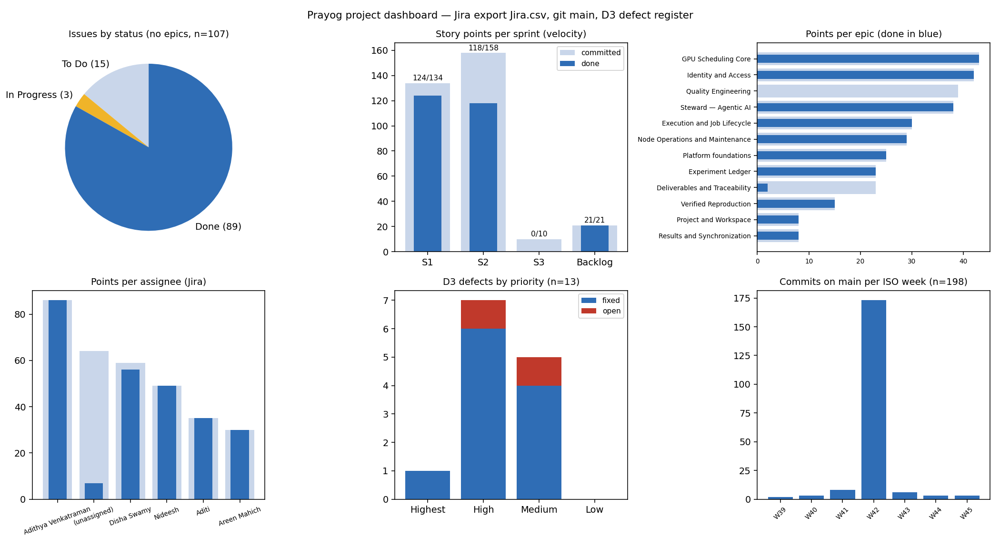

# 1. The project in one page

**Prayog** is a shared GPU platform for IIT Kanpur: students and researchers get access approved by their professor and an admin, submit GPU jobs to a fair-share scheduler that places them on lab-donated GPU nodes, record every run in an experiment ledger that can rebuild it from a snapshot, and get failures diagnosed by an AI agent (the **Steward**). Team: Adithya Venkatraman, Areen Mahich, Disha Swamy (lead, repository owner), Aditi, Nideesh.

| Measure (6 Nov 2026) | Value |
|---|---|
| Repository | `Dishaswamy/Prayog`, `main` at `18767aa`; 20 merged pull requests (#4–#26), plus 10 merged from the working repository `baymaxisme/Prayog` when the ledger was integrated |
| Delivered source | 23,272 non-blank lines (backend 12,867 · Steward 6,286 · CLI 1,548 · web 2,571); 10,713 lines of tests |
| Processes | API, scheduler tick, node agent, Steward worker, Steward Runtime, PostgreSQL 16 |
| Automated tests | 1282: backend 878 (Linux, final build), Steward 222, CLI 165, backend–Steward harness 17; 1271 pass, 0 fail, 11 skipped (Docker; run in CI) |
| Coverage | 85.4% of production Python (backend 84.2%, Steward 86.6%, CLI 91.0%) |
| Jira | 119 issues (78 stories, 28 tasks, 12 epics, 1 sub-task); 89 Done, 3 In Progress, 27 To Do (incl. 12 epics) in the 16 Oct export |
| Story points | 323 planned; 263 done; Sprint 1 124/134 (93%), Sprint 2 118/158 (75%) in the 16 Oct export |
| D3 defects | 20 recorded, 19 fixed with regression tests, 1 CI fix, 0 open (Defect history) |

# 2. Dashboard

How to read it. *Issues by status* and the *points* panels come from the Jira export of 16 October joined with the backlog plan (`PRAYOG_backlog_jira_import.csv`; Jira key = plan key + 4 because the four Jira sample issues took keys 1–4). Epics are excluded from the status count. *D3 defects* come from `evidence/jira_bugs_import.csv`, which is ready to import as Jira Bugs. *Commits per week* is from `git log main` — the week-42 spike (173 commits) is the working repository's history landing on `main` when the ledger was integrated on 15 October, not a week of 173 separate pushes.

**Live Jira dashboard.** The board's own dashboard (sprint burndown, velocity chart, created-vs-resolved, open bugs by age, a filter per component, and the saved filter `labels in (D2, D3)`, as configured in sprint-plan section 14) should be screenshotted from Jira after the bug import and attached as `evidence/jira_dashboard.png`. That step needs a team member signed in to Jira; it is not something this package can produce from the repository.

# 3. Status by subsystem

| Subsystem | Owner | Status | Evidence |
|---|---|---|---|
| Identity and access (registration, two-step approval, CLI login, expiry, revocation, lockout, audit) | Disha, Aditi | done; extension requests and account deactivation have no tests (PRAYOG-38, -41) | `test_auth_routes`, `test_access_request_purpose`, `test_review_fixes`, probes A01–A19 |
| GPU scheduling core (eligibility, classes P0–P3, fair-share score, passes, atomic claim) | Adithya | done | `test_cases/gpu/scheduler/`, `test_pass_equivalence`, `test_lab_scheduling`, concurrency C1–C6 |
| Execution and job lifecycle (dispatch, hardened agent, walltime, requeue) | Adithya, Aditi | done; real-GPU run not yet verified | `test_gpu_agent_api`, `test_node_agent_*`, CI container tests, drill F1 |
| Node operations (register, drain, return, decommission, sharing, maintenance, hardware investigation) | Adithya, Nideesh | done | `test_cases/gpu/scheduler/test_nodes`, `test_reaper`, `test_liveness`, `test_node_sharing`, `test_hardware_investigation`, `test_pool_picture`, drills |
| Experiment ledger and reproduction (snapshots, outbox, professor/admin views, handover, rebuild, comparator) | Nideesh | done | 19 `test_mlflow_*` modules, CI e2e |
| Steward S1–S4 | Areen | done with the heuristic adapter; live Claude call and the ~100-case evaluation not done | Steward suite (outside `main`), `tests_steward_check` |
| CLI client | Disha | done | 165 CLI tests |
| Web application (all four roles) | Areen | done (PR #26) | `test_web_app`, probes A18, A21 |
| Quality engineering (EP-11) | all | this deliverable | reports 01–07 |
| Deployment (PRAYOG-24) | — | Docker image and compose stack built and run locally; **not yet deployed to a cloud service** (needs a team member's account); systemd/nginx/TLS/backups not exercised | Deployment section 3 and section 9 |

# 4. Sprint history

| Sprint | Dates | Committed | Done (16 Oct export) | Notes |
|---|---|---|---|---|
| D1 (pre-sprint) | 1–27 Sep | — | — | three SRSs, Integrated Requirements Specification, SADD v1.1 (submitted) and v2.0, verification package |
| Sprint 1 | 28 Sep – 15 Oct | 134 | 124 (93%) | calibration sprint; the GPU critical path shared by four members; D2 on 15 Oct |
| Sprint 2 | 16 Oct – 6 Nov | 158 | 118 (75%) at 16 Oct; EP-11 and EP-12 items completed by this package | CLI, scheduler hardening, Steward integration, web app, code review, D3 |
| Sprint 3 | 7–13 Nov | 10 | — | demonstration rehearsal |

# 5. Risks carried into the demonstration

| Risk | Likelihood | Impact | Mitigation |
|---|---|---|---|
| No cloud deployment yet | certain until someone deploys | high (course section 16) | Deployment section 3B; about 20 minutes with a cloud account |
| No real GPU or Docker on the demo laptop | high | medium | simulated agents (as in drills); the hardened container path is shown from CI logs |
| Live Claude call never made | high | medium | heuristic adapter is the default; a Claude run needs an API key and a spend cap |
| Jira history thin (bulk import on 11 Oct, no bugs) | certain | medium (grading) | import the 13 bugs; screenshot the dashboard; link PRs to issue keys |
| Five Windows-only test failures confuse a reviewer running locally | medium | low | run on Linux/CI; the Test report lists each with its cause |

# 6. Retrospective

**What worked**

- One authoritative requirements document (the Integrated Specification) after D1's verification found the three SRSs in conflict; requirement IDs then flowed into code (189 IDs cited in source).
- Database-enforced invariants (row locks, partial unique indexes, RLS, append-only audit) — the concurrency suite found no data race, only an error-handling gap (D3-03).
- CI on real PostgreSQL and real hardened containers from Sprint 1; it caught the platform-image drift (D3-12) the day it happened.
- AI assistance cut the cost of producing code roughly tenfold (Costing section 3); keeping the human on decisions and pushes kept that safe.

**What did not**

- **Untracked work.** About a third of effort (web app, CLI rebuild fix, reviews, CI repairs, documents) has no Jira issue, and Jira has no Bug issues at all. The board under-reports both the work and its quality.
- **Tests outside the repository.** At the lead's request the Steward's 222 tests stay out of `main`; 18 Done stories have no automated test in the repository (Traceability section 3). A reviewer cannot re-verify them from `main` alone.
- **Non-functional testing came last.** Fourteen of the twenty D3 defects were found only by concurrency, load, fault-injection, static and adversarial testing on the final day, including the two most serious late finds (D3-08, D3-14). They were fixed the same day, which left less time for review than they deserved.
- **Tests held back too long.** The GPU suite stayed out of the repository until this deliverable, so teammates' changes broke 68 of its tests without anyone noticing, and the first coverage reading showed the reaper at 0%.
- **Branch hygiene.** An unreviewed push to `main` (15 Oct, reverted) and work in progress pushed as non-`feature/` branches that CI did not run.

**Actions for Sprint 3 and beyond**

1. Import the D3 bugs; from now on every defect becomes a Jira Bug when found.
2. Add the concurrency suite, `test_database_unavailable`, `pip-audit` and `bandit -ll` to CI; keep the load and drill scripts in the repository under `tools/`.
3. Add the missing tests for PRAYOG-21, -38, -40, -41, -43, -69, and deploy to a cloud service.
4. Move the Steward suite into the repository (or a CI job that checks out `steward-full`) so its 222 tests guard `main`.
